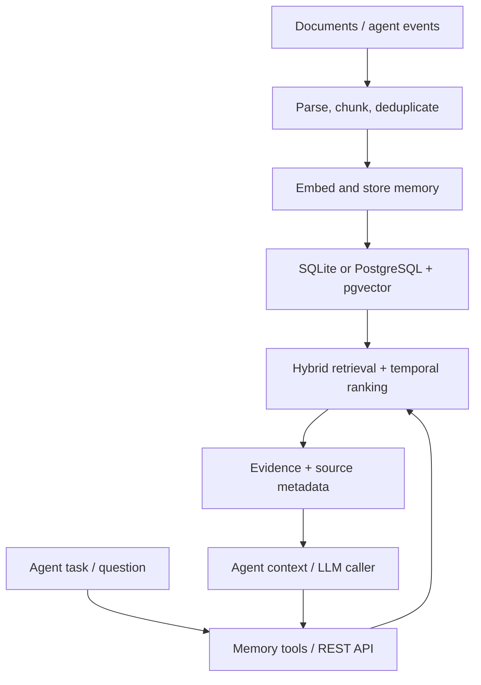

# Agent Memory — long-term memory for AI agents

[](https://github.com/szechung2000/agent-memory/actions/workflows/ci.yml)
[](LICENSE)

**An AI agent can finish a task but forget the facts it learned.** This project is a small,
reusable memory service that lets agents store facts and events, retrieve relevant evidence,
and assemble context for the next task. It separates memory from the model so multiple agents
can use the same interface.

I built it to explore a practical AI-engineering question: **How do you make an agent's
memory reliable, inspectable, and measurable?** It is a working prototype, not a hosted
multi-tenant product.

## Try the AI workflow in one command

Requires **Python 3.11+** and [uv](https://docs.astral.sh/uv/). No Docker, API key, or model
download is needed for this demonstration.

```bash
git clone https://github.com/szechung2000/agent-memory.git
cd agent-memory
uv sync --all-groups
uv run python -m agent_memory.demo.fde_workflow
```

The demo uses **synthetic CMBS loan and servicing data** and a deterministic hash embedding
model. It prints a JSON trace of four actual operations:

1. **Ingest:** split and store three source facts; ingest them again to prove content-hash deduplication.
2. **Retrieve:** an agent calls `memory_search` to find a September loan delinquency.
3. **Ground:** `memory_context` supplies evidence with stable memory IDs and source metadata.
4. **Remember:** `memory_write` saves the review request as an episodic event.

Example evidence from the trace (IDs and scores vary):

```json
{
  "content": "CMBS Loan A: September 2026 remittance reports a 30-day delinquency.",
  "source": "synthetic/servicer-remittance-sep-2026.txt",
  "metadata": {"source": "synthetic/servicer-remittance-sep-2026.txt", "chunk_index": 0}
}
```

This is a **deterministic tool-workflow demo**, not an LLM-generated answer or real loan analysis.
For an optional LLM tool-calling loop, see [Telegram agent](#optional-llm-agent).

## Architecture



| Component | Implementation | Why it matters |
|---|---|---|
| Ingestion | `.md`, `.txt`, and text-based `.pdf`; chunking, frontmatter, content-hash dedupe | Repeatable imports |
| Memory model | Semantic facts and episodic events; namespaces and user IDs | Separate long-term facts from activity logs |
| Retrieval | 70% cosine similarity + 30% keyword overlap; temporal penalty | Search by meaning and exact terms, including date-sensitive questions |
| Advanced retrieval | Query decomposition, multi-hop expansion, optional local cross-encoder reranker | Experiments for questions that need several facts |
| Agent interface | OpenAI-format tools: `memory_write`, `memory_search`, `memory_context` | Model-agnostic tool contract |
| Storage | SQLite locally; PostgreSQL with pgvector and HNSW candidate search | Quick demo and a scalable-backend experiment |
| Evaluation | Four golden sets, retrieval hit checks, latency and ablation reports | Test retrieval changes rather than relying on anecdotes |

Source IDs and metadata are returned with memory search/context results. **Citation rendering
and verification in an LLM's final answer are not implemented**; provenance alone does not
prove an answer is grounded. The next step is citation-aware generation with source checks.

## Run the REST API

Start with local SQLite (the default). With no API key or local model installed, the app
uses deterministic hash embeddings. These test the pipeline, **not semantic retrieval quality**.

```bash
uv run uvicorn agent_memory.api.main:app --host 127.0.0.1 --port 8000
```

In a second terminal:

```bash
curl -fsS http://127.0.0.1:8000/healthz
curl -fsS http://127.0.0.1:8000/remember \
  -H 'content-type: application/json' \
  -d '{"content":"The CMBS remittance lists a 30-day delinquency", "namespace":"demo", "metadata":{"source":"example.txt"}}'
curl -fsS http://127.0.0.1:8000/recall \
  -H 'content-type: application/json' \
  -d '{"query":"CMBS delinquency", "namespace":"demo", "k":3}'
curl -fsS 'http://127.0.0.1:8000/context?query=CMBS%20delinquency&k=3'
```

Interactive API schema: [http://127.0.0.1:8000/docs](http://127.0.0.1:8000/docs).
For idempotent updates from an external source, use `PUT /v1/memories/{external_id}`.

For real local semantic embeddings (model download required on first run):

```bash
uv sync --extra local-embeddings --all-groups
# Then restart the API / CLI. BGE small-en-v1.5 runs locally after download.
```

The embedder order is: `AM_OPENAI_API_KEY` → local BGE if installed → hash fallback.
The PostgreSQL schema uses **384-dimensional vectors**, including OpenAI embeddings requested
at 384 dimensions. Do not change the embedder on a populated database without re-embedding
existing records. For the Postgres option:

```bash
cp .env.example .env  # optional: add AM_OPENAI_API_KEY to .env
docker compose up --build
curl -fsS http://127.0.0.1:8000/healthz
```

Docker Compose starts PostgreSQL/pgvector and the API on **localhost only**. The local
SQLite command and Docker Compose are alternatives; stop one API before starting the other.
Redis is not used by the shipped code.

## Agent and CLI interfaces

An LLM caller can pass the exposed function schemas to its tool-calling API:

```python
from agent_memory.tools import MemoryToolExecutor

# repo is a MemoryRepository or PgVectorRepository; embedder embeds query text.
executor = MemoryToolExecutor(repo, embedder)
tools = executor.tools  # OpenAI-compatible function schemas
evidence_json = executor.execute("memory_search", {"query": "CMBS loan status", "k": 5})
```

The CLI supports document imports, searching, episodic-to-semantic consolidation with
manual review, and eval history:

```bash
uv run am ingest ./my-notes --namespace brain
uv run am recall "loan modification" --namespace brain
uv run am recall --multihop "loan modifications and extensions"
uv run am consolidate --review
uv run am eval-history
```

PDF import needs `pypdf` (`uv sync --all-groups` installs it as a dev dependency).
For a runtime-only installation, install `pypdf` separately. Scanned PDFs need OCR upstream.

### Optional LLM agent

The [Telegram example](src/agent_memory/demo/telegram_agent.py) demonstrates a bounded
OpenAI function-calling loop using the same memory tools. It needs a Telegram bot token and,
for generated replies, an OpenAI API key:

```bash
uv sync --extra telegram --all-groups
export TELEGRAM_BOT_TOKEN='your-bot-token'
export AM_OPENAI_API_KEY='your-api-key'  # omit for a no-LLM tool demo
uv run python -m agent_memory.demo.telegram_agent
```

Avoid sending confidential data to external model providers. The optional agent requires
external accounts and was not exercised by the local smoke tests.

## Evaluation: what is actually measured

```bash
uv run python -m agent_memory.evals.run_golden
uv run pytest -q
uv run ruff check .
```

The four handcrafted golden suites contain **36 retrieval cases**. One local run with hash
embeddings and heuristic decomposition produced:

| Suite | Cases | Retrieval check passed |
|---|---:|---:|
| Glossary | 5 | 5/5 |
| Temporal | 5 | 5/5 |
| Multi-hop | 6 | 4/6 |
| Research papers (L0–L3) | 20 | 17/20 |

These are **retrieval-level** checks, not LLM answer accuracy. The scorer accepts a majority
of required evidence for multi-fact questions; small suites and heuristic splits limit how
well results generalize. CI tests use lower minimum thresholds for the hash fallback.
See [ablation results](docs/ablation-report.md) and the
[evaluation runner](src/agent_memory/evals/run_golden.py) for the exact method.

## Interview discussion: design choices and gaps

- **Why a separate service?** Agent tools and a REST API share a memory contract; a task
  agent can change models without rewriting storage.
- **Why hybrid retrieval?** Exact IDs and terms matter along with semantic similarity.
  The SQLite backend scans rows; PostgreSQL uses pgvector candidates and Python keyword
  scoring. True server-side sparse retrieval/fusion is future work.
- **How are errors controlled?** Deduplication, source metadata, targeted retrieval tests,
  and bounded tool-calling rounds. The demo does not prove answer correctness.
- **What would production require?** Authentication, tenant authorization, rate limits,
  migrations, observability, retries, corpus-scale evaluations, and citation validation.
  Do **not** expose this prototype's unauthenticated API to the public internet.

The [architecture proposal](docs/memory-architecture.md) and
[project breakdown](docs/project-breakdown.md) describe additional ideas; they are not
all implemented. A typed [TypeScript client](packages/client-ts) is also included.
