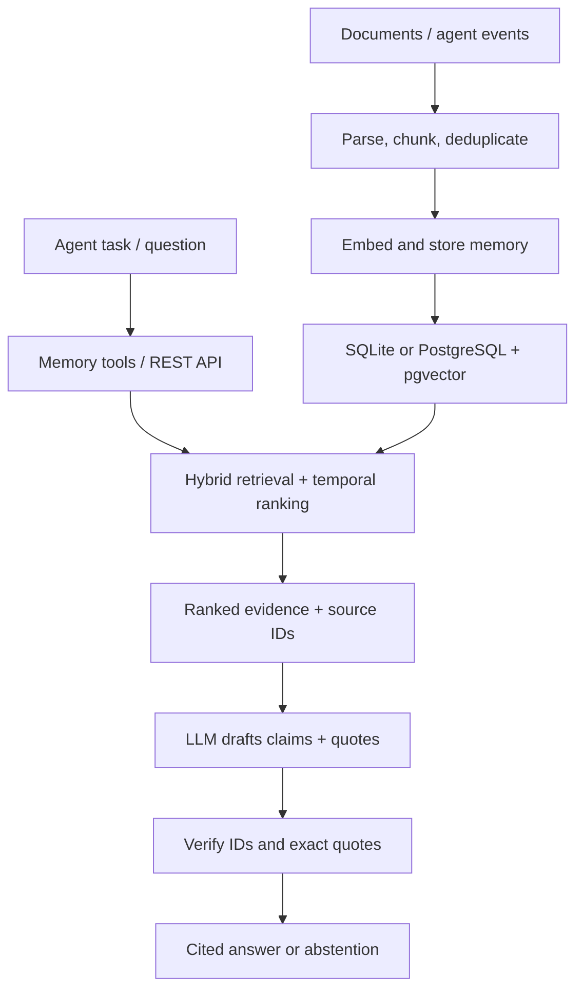

# Agent Memory — long-term memory for AI agents

[](https://github.com/szechung2000/agent-memory/actions/workflows/ci.yml)
[](LICENSE)

**An AI agent can finish a task but forget the facts it learned.** This project is a small,
reusable memory service that lets agents store facts and events, retrieve relevant evidence,
and assemble context for the next task. It separates memory from the model so multiple agents
can use the same interface.

I built it to explore a practical AI-engineering question: **How do you make an agent's
memory reliable, inspectable, and measurable?** It is a working prototype, not a hosted
multi-tenant product.

## Try the AI workflow in one command

Requires **Python 3.11+** and [uv](https://docs.astral.sh/uv/). No Docker, API key, or model
download is needed for this demonstration.

```bash
git clone https://github.com/szechung2000/agent-memory.git
cd agent-memory
uv sync --all-groups
uv run python -m agent_memory.demo.fde_workflow
```

The demo uses **synthetic CMBS loan and servicing data** and a deterministic hash embedding
model. It prints a JSON trace of four actual operations:

1. **Ingest:** split and store three source facts; ingest them again to prove content-hash deduplication.
2. **Retrieve:** an agent calls `memory_search` to find a September loan delinquency.
3. **Ground:** `memory_context` supplies evidence with stable memory IDs and source metadata.
4. **Remember:** `memory_write` saves the review request as an episodic event.

Example evidence from the trace (IDs and scores vary):

```json
{
  "content": "CMBS Loan A: September 2026 remittance reports a 30-day delinquency.",
  "source": "synthetic/servicer-remittance-sep-2026.txt",
  "metadata": {"source": "synthetic/servicer-remittance-sep-2026.txt", "chunk_index": 0}
}
```

This is a **deterministic tool-workflow demo**, not an LLM-generated answer or real loan analysis.
For an optional LLM tool-calling loop, see [Telegram agent](#optional-llm-agent).

### Try citation-checked answers

```bash
uv run python -m agent_memory.demo.cited_answer
```

This second offline example reuses the synthetic CMBS evidence and demonstrates the full
retrieval → claim drafting → source-quote verification → citation formatting path. Its
generator is **scripted**, not an LLM; the retrieval and citation validator are real:

```text
Synthetic CMBS Loan A was 30 days delinquent in September 2026. [S2]
```

The response also returns a structured `citations` list with the memory ID, the exact
source quote, file identifier, and ingestion metadata. Reference numbers depend on ranking.
See [live LLM answers](#optional-live-llm-answers) for the real generation path.

## Architecture



| Component | Implementation | Why it matters |
|---|---|---|
| Ingestion | `.md`, `.txt`, and text-based `.pdf`; chunking, frontmatter, content-hash dedupe | Repeatable imports |
| Memory model | Semantic facts and episodic events; namespaces and user IDs | Separate long-term facts from activity logs |
| Retrieval | 70% cosine similarity + 30% keyword overlap; temporal penalty | Search by meaning and exact terms, including date-sensitive questions |
| Advanced retrieval | Query decomposition, multi-hop expansion, optional local cross-encoder reranker | Experiments for questions that need several facts |
| Agent interface | OpenAI-format tools: `memory_write`, `memory_search`, `memory_context` | Model-agnostic tool contract |
| Cited answers | Optional OpenAI generator + strict source ID/quote checks | Return only referenced evidence and fail closed on invalid citations |
| Storage | SQLite locally; PostgreSQL with pgvector and HNSW candidate search | Quick demo and a scalable-backend experiment |
| Evaluation | Four golden sets, retrieval hit checks, latency and ablation reports | Test retrieval changes rather than relying on anecdotes |

### Implemented path versus experiments

The main demonstration follows **ingest → retrieve → optional rerank → generate →
verify citations**. HTTP and agent tools share the same retrieval rule and context
evidence assembly; SQLite and pgvector use different candidate selection but the
same hybrid score calculation.

- **Core:** document ingestion, memory storage and recall, source-grounded answers,
  synthetic CMBS evaluation, Docker integration tests, and request telemetry.
- **Optional experiments:** multi-hop query expansion, LLM query decomposition,
  episode consolidation, and the Telegram agent. These are not prerequisites for
  the cited-answer API and are not required to run the offline FDE demo.
- **Not implemented:** an entity/edge knowledge graph, tenant authorization,
  production database migrations, and external monitoring infrastructure. Some
  architecture documents describe proposals rather than shipped features.

Ingestion treats identical text from **different namespaces or source files** as
different memories. Re-importing the same source in the same namespace is skipped;
older global hash records are recognized when their stored source and namespace
match. Without source metadata, identical text within a namespace is treated as
the same source. The database schema has one runtime bootstrap path; the existing
Alembic scaffold is **not yet a production migration system**.

**Scope of citation verification:** The checker confirms that each generated claim cites an
actual retrieved memory and quotes text from it. It constructs the citation markers itself,
rejects invalid output, and abstains when evidence is absent. It **cannot prove that each
claim logically follows from the quote**. That needs claim-level entailment evaluation,
human review, or a separate verifier. Retrieved documents remain untrusted input.

## Run the REST API

Start with local SQLite (the default). With no API key or local model installed, the app
uses deterministic hash embeddings. These test the pipeline, **not semantic retrieval quality**.

```bash
uv run uvicorn agent_memory.api.main:app --host 127.0.0.1 --port 8000
```

In a second terminal:

```bash
curl -fsS http://127.0.0.1:8000/healthz
curl -fsS http://127.0.0.1:8000/remember \
  -H 'content-type: application/json' \
  -d '{"content":"The CMBS remittance lists a 30-day delinquency", "namespace":"demo", "metadata":{"source":"example.txt"}}'
curl -fsS http://127.0.0.1:8000/recall \
  -H 'content-type: application/json' \
  -d '{"query":"CMBS delinquency", "namespace":"demo", "k":3}'
curl -fsS 'http://127.0.0.1:8000/context?query=CMBS%20delinquency&k=3'
```

Interactive API schema: [http://127.0.0.1:8000/docs](http://127.0.0.1:8000/docs).
For idempotent updates from an external source, use `PUT /v1/memories/{external_id}`.

### Optional live LLM answers

Start the API with `AM_OPENAI_API_KEY` configured (and a **fresh database** if you are
switching embedding models). The new `POST /answer` endpoint performs retrieval,
optional reranking, LLM generation, and citation validation:

```bash
export AM_OPENAI_API_KEY='your-api-key'
uv run uvicorn agent_memory.api.main:app --host 127.0.0.1 --port 8000
```

After inserting the example evidence using `/remember` above:

```bash
curl -fsS http://127.0.0.1:8000/answer \
  -H 'content-type: application/json' \
  -d '{"question":"What delinquency does the CMBS remittance show?","namespace":"demo","k":3}'
```

The response contains `status`, `answer`, `claims`, and `citations` with exact quotes
and source metadata. If no evidence is found (or the model abstains), the service returns
`insufficient_evidence`. Invalid, fabricated, or missing citations cause HTTP **502**;
the unverified answer is not returned. Without a generation key, this endpoint returns
HTTP **503**. `AM_GENERATION_MODEL` defaults to `gpt-4o-mini`.

Set `"rerank":true` to request local cross-encoder reranking before generation. It needs
the `local-embeddings` extra and the reranker model download; otherwise the endpoint
returns **503** instead of claiming that reranking happened.

This optional path sends both the question and retrieved memory content to OpenAI.
Do not submit confidential client or employer data.

For real local semantic embeddings (model download required on first run):

```bash
uv sync --extra local-embeddings --all-groups
# Then restart the API / CLI. BGE small-en-v1.5 runs locally after download.
```

The embedder order is: `AM_OPENAI_API_KEY` → local BGE if installed → hash fallback.
The PostgreSQL schema uses **384-dimensional vectors**, including OpenAI embeddings requested
at 384 dimensions. Do not change the embedder on a populated database without re-embedding
existing records. For the Postgres option:

```bash
cp .env.example .env  # optional: add AM_OPENAI_API_KEY to .env
docker compose up --build
curl -fsS http://127.0.0.1:8000/healthz
```

Docker Compose starts PostgreSQL/pgvector and the API on **localhost only**. The local
SQLite command and Docker Compose are alternatives; stop one API before starting the other.
Redis is not used by the shipped code.

### Test the real PostgreSQL/pgvector API

Run the isolated end-to-end stack with **one command** (Docker Compose v2 required):

```bash
docker compose -p agent-memory-test --profile test up --build \
  --abort-on-container-exit --exit-code-from integration integration
docker compose -p agent-memory-test --profile test down --volumes --remove-orphans
```

The test profile starts a temporary PostgreSQL/pgvector container **without a published
port or persistent volume**. Each test also creates and drops its own randomly named
schema. This checks HTTP writes, idempotent upserts, vector storage, retrieval, context,
cited answers, abstention, and the HNSW index. It uses deterministic test embeddings
and a scripted answer generator: **no API key, external model, or production data**.
The `postgres-integration` CI job runs the same stack for each PR.

For an existing, disposable Postgres test database, `AM_TEST_PG_URI=... uv run pytest
tests/test_pg_integration.py tests/test_pg_api_integration.py` runs the same tests without
Docker. The configured test role must be allowed to create schemas and install pgvector.
Never point `AM_TEST_PG_URI` at a production database.

### Operations and failure behavior

- `/healthz` checks the process; `/readyz` verifies a live database query. A failed
  database operation returns **503** with a generic error, not a SQL statement.
- Every HTTP response contains `X-Request-ID` (a safe caller-supplied ID is retained).
  Structured JSON logs include method, route template, response code, and duration,
  without the question, retrieved text, or raw URL parameters.
- Successful `/answer` requests log answer/abstention state, retrieved count,
  reranker use, model name, and provider token usage when available.
- Model timeouts return **504**; connection/rate-limit failures return **503**;
  other provider errors return **502**. Provider error bodies are not returned.

See [reliability and test boundary](docs/reliability.md) for exact test scope and
remaining work. The API still has **no authentication, authorization, or rate limiting**;
do not deploy it on a public network as-is.

## Agent and CLI interfaces

An LLM caller can pass the exposed function schemas to its tool-calling API:

```python
from agent_memory.tools import MemoryToolExecutor

# repo is a MemoryRepository or PgVectorRepository; embedder embeds query text.
executor = MemoryToolExecutor(repo, embedder)
tools = executor.tools  # OpenAI-compatible function schemas
evidence_json = executor.execute("memory_search", {"query": "CMBS loan status", "k": 5})
```

The CLI supports document imports, searching, episodic-to-semantic consolidation with
manual review, and eval history:

```bash
uv run am ingest ./my-notes --namespace brain
uv run am recall "loan modification" --namespace brain
uv run am recall --multihop "loan modifications and extensions"
uv run am consolidate --review
uv run am eval-history
```

PDF import needs `pypdf` (`uv sync --all-groups` installs it as a dev dependency).
For a runtime-only installation, install `pypdf` separately. Scanned PDFs need OCR upstream.

### Optional LLM agent

The [Telegram example](src/agent_memory/demo/telegram_agent.py) demonstrates a bounded
OpenAI function-calling loop using the same memory tools. It needs a Telegram bot token and,
for generated replies, an OpenAI API key:

```bash
uv sync --extra telegram --all-groups
export TELEGRAM_BOT_TOKEN='your-bot-token'
export AM_OPENAI_API_KEY='your-api-key'  # omit for a no-LLM tool demo
uv run python -m agent_memory.demo.telegram_agent
```

Avoid sending confidential data to external model providers. The optional agent requires
external accounts and was not exercised by the local smoke tests.

## Evaluation: what is actually measured

**New: synthetic CMBS RAG quality benchmark.** Run a repeatable baseline vs
BM25-reranked comparison on 32 synthetic source documents and 45 labeled
questions (direct, multi-document, temporal, unanswerable, and restated data):

```bash
uv run python -m agent_memory.evals.cmbs_benchmark --output evals/cmbs/runs/offline.json
```

The offline hash-embedding run measures retrieval only. The separate answer
scorer computes quote anchoring, labeled citation precision/recall, abstention
precision/recall, and strict key-fact coverage from a **complete 45-case
prediction file** or an explicitly opted-in live model run. It never treats
scripted fixture predictions as live LLM quality. See the
[benchmark methodology and measured results](docs/cmbs-benchmark.md) for
reproduction, actual A/B scores, regressions, and limitations.

The original four golden suites remain available:

```bash
uv run python -m agent_memory.evals.run_golden
uv run pytest -q
uv run ruff check .
```

The four handcrafted golden suites contain **36 retrieval cases**. One local run with hash
embeddings and heuristic decomposition produced:

| Suite | Cases | Retrieval check passed |
|---|---:|---:|
| Glossary | 5 | 5/5 |
| Temporal | 5 | 5/5 |
| Multi-hop | 6 | 4/6 |
| Research papers (L0–L3) | 20 | 17/20 |

These are **retrieval-level** checks, not LLM answer accuracy. Citation-specific unit and
HTTP tests also check valid quotes, invented source IDs, malformed outputs, and abstentions,
using a fake generator so CI needs no API key. The retrieval scorer accepts a majority
of required evidence for multi-fact questions; small suites and heuristic splits limit how
well results generalize. CI tests use lower minimum thresholds for the hash fallback.
See [ablation results](docs/ablation-report.md) and the
[evaluation runner](src/agent_memory/evals/run_golden.py) for the exact method.

## Interview discussion: design choices and gaps

- **Why a separate service?** Agent tools and a REST API share a memory contract; a task
  agent can change models without rewriting storage.
- **Why hybrid retrieval?** Exact IDs and terms matter along with semantic similarity.
  The SQLite backend scans rows; PostgreSQL uses pgvector candidates and Python keyword
  scoring. True server-side sparse retrieval/fusion is future work.
- **How are errors controlled?** Deduplication, source metadata, citation-quote checking,
  safe abstention, targeted retrieval tests, and bounded tool-calling rounds. These
  controls still do not prove semantic answer correctness.
- **What would production require?** Authentication, tenant authorization, rate limits,
  migrations, distributed tracing and alerts, corpus-scale evaluations, and claim-level factual
  verification beyond citation text matching.
  Do **not** expose this prototype's unauthenticated API to the public internet.

The [architecture proposal](docs/memory-architecture.md) and
[project breakdown](docs/project-breakdown.md) describe additional ideas; they are not
all implemented. A typed [TypeScript client](packages/client-ts) is also included.
